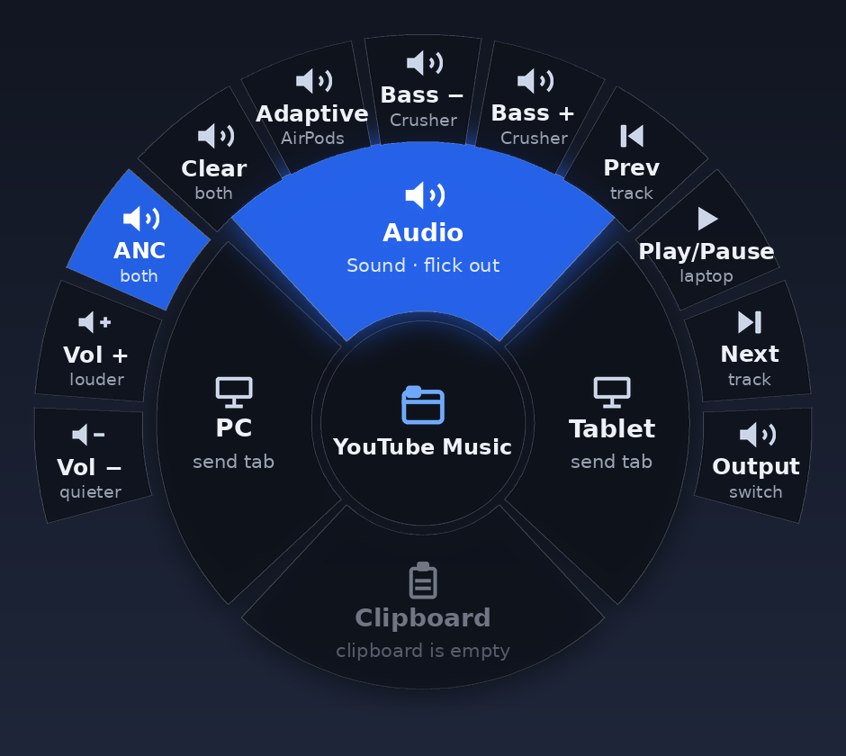
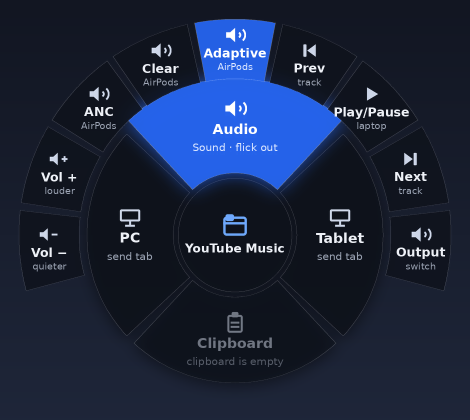
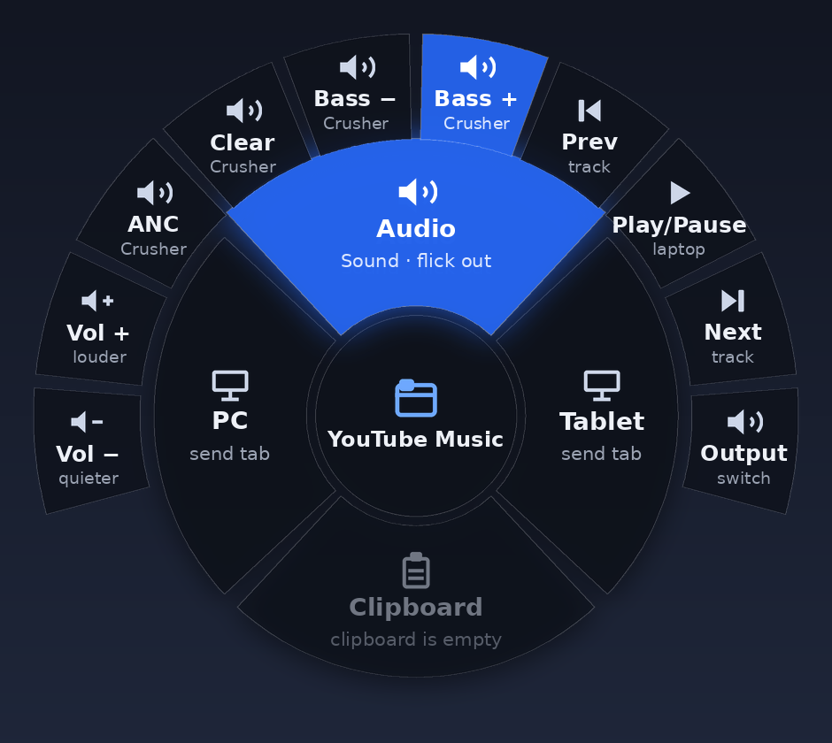
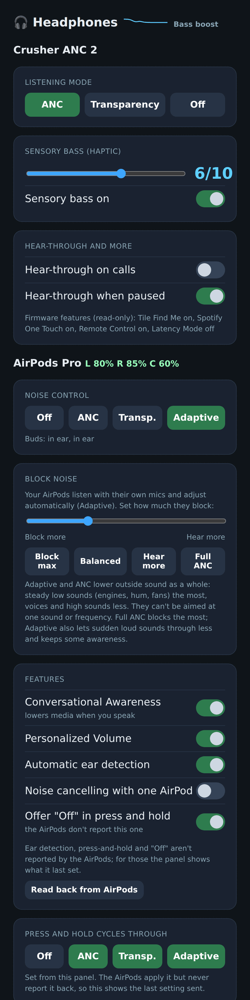
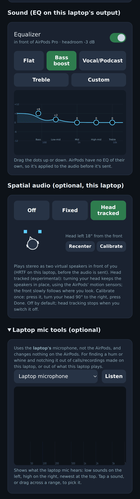
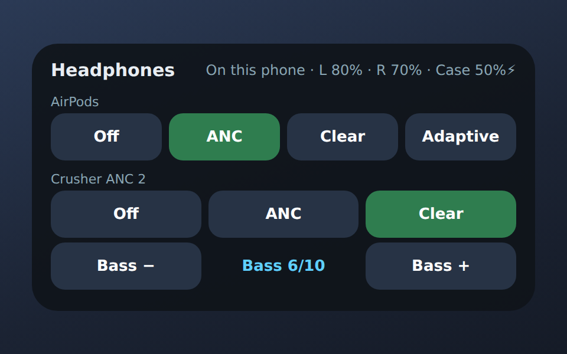
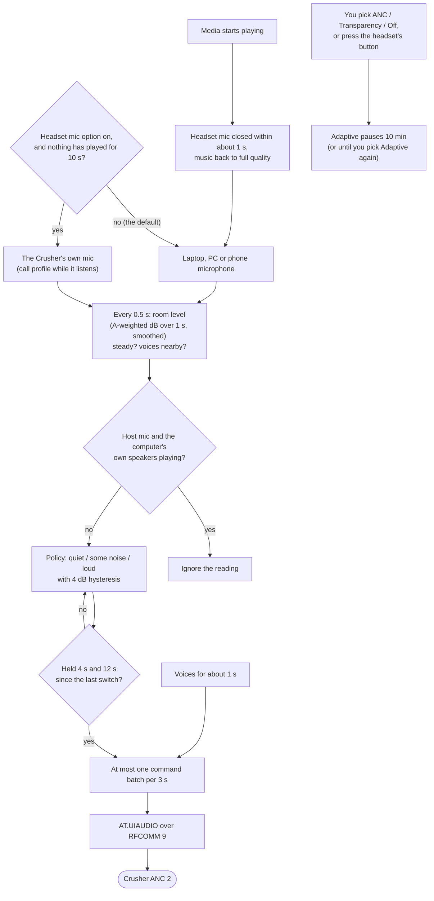
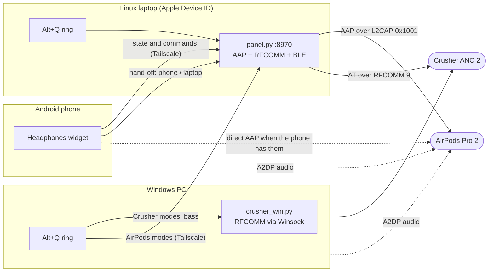
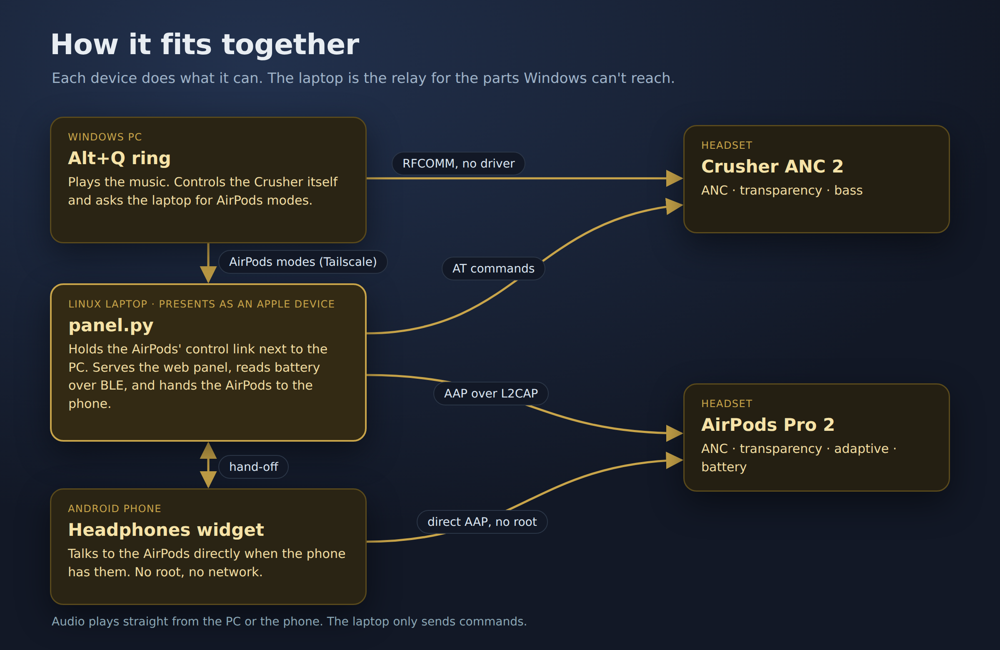
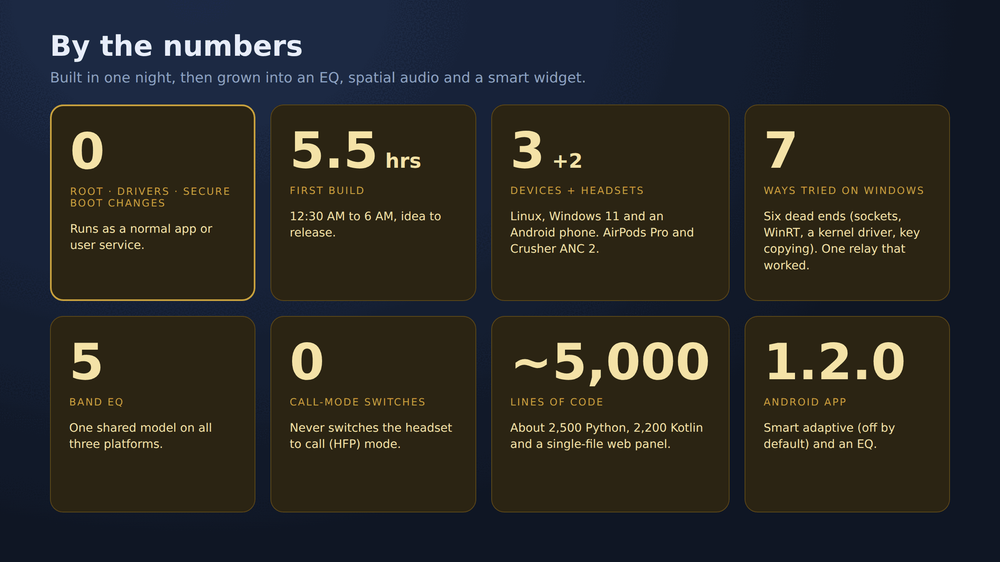

# crossdevice-audio

One set of headphone controls across a **Linux laptop**, a **Windows PC** and an **Android phone**,
for **AirPods Pro 2** and the **Skullcandy Crusher ANC 2**.

Noise cancelling, transparency, adaptive mode, bass, volume, media keys and battery are all available
from a radial flick menu on both computers, from a web panel, and from a home-screen widget on the phone.
It also has a shared 5-band EQ with a draggable curve, the AirPods' adaptive noise level and settings,
and the Crusher's extra settings (see [Customizing the sound](#customizing-the-sound)).

Two things are optional and off by default: **spatial audio** (Linux laptop only, with experimental head
tracking) and the **laptop mic tools** (a sound viewer and notch filters). The controls never switch the
headset to call (HFP) mode, so audio quality stays the same while you use them; only Live Translation and
Crusher Adaptive's opt-in headset mic (while nothing plays) use it.

It doesn't need an iPhone, a kernel driver, a Secure Boot change, a USB dongle or a rooted phone.

<p align="center">
  
</p>

## What it does

| Where | How you use it | What you get |
|---|---|---|
| **Windows PC** | `Alt+Q`, flick up, then flick out | Volume, media keys and Crusher modes (including Crusher Adaptive) and bass. AirPods modes go through the laptop. |
| **Linux laptop** | `Alt+Q`, flick up, then flick out | The same ring, plus an audio output switcher. The laptop is what talks to the AirPods. |
| **Web panel** | `https://<laptop>:8970` over Tailscale | Every control with live state and AirPods battery. |
| **Android widget** | Home screen | AirPods modes and battery straight from the phone, with no laptop or Tailscale needed. When the AirPods aren't on the phone it works through the laptop. |

The ring only shows controls that the connected headphones can actually do. AirPods get Adaptive, the
Crusher gets Bass (and Adaptive too, once [Crusher Adaptive](#crusher-adaptive-mode) is set up on that
computer), and with nothing connected only volume and track controls are left:

| Both connected | AirPods only | Crusher only |
|---|---|---|
|  |  |  |

### The web panel

The panel is one page served by the laptop (`laptop/panel.html`). It is shown here on a phone-width screen
with example data, in two parts: the headphone controls first, then EQ, spatial audio and the laptop mic tools.

<p align="center">
  
  &nbsp;&nbsp;
  
</p>

- **Block noise (AirPods).** The slider runs from *Block more* to *Hear more* and sets the Adaptive level.
  The buttons are shortcuts: *Block max*, *Balanced*, *Hear more* (all Adaptive at different levels) and
  *Full ANC*. The AirPods' own microphones do the listening, so it works with nothing playing through the laptop.
- **Equalizer.** One volume, with automatic headroom so boosts don't clip. On the laptop it is a PipeWire
  smart filter in front of the current output.
- **Spatial audio** is Linux only and optional. Head tracking is experimental.
- **Laptop mic tools** is optional. It uses the laptop's microphone, not the AirPods, to find a hum or whine and
  notch it out of sound that goes through the laptop.
- **Crusher extras** show hear-through on calls and when paused, plus the firmware's feature flags (read-only).

### The Android widget

<p align="center">
  
</p>
<p align="center"><sub>The home-screen widget (a mockup of its real layout)</sub></p>

## The interesting parts

**1. AirPods noise control on Windows with no driver.**
AirPods are controlled through Apple's AAP protocol, which runs over classic Bluetooth L2CAP on
channel `0x1001`. Normal Windows programs can't open that kind of connection: Winsock's L2CAP sockets
fail with WSAESOCKTNOSUPPORT (10044) or WSAENETDOWN (10050), and WinRT has no classic L2CAP API at all.
The only way in is a kernel driver, which rules out Secure Boot on stock settings. Instead of fighting
Windows, this project gives the job to another machine:

- The **Linux laptop** presents Apple's Bluetooth Device ID (`DeviceID = bluetooth:004C:0000:0000`).
  AirPods only allow two connections at once to hosts that look like Apple devices.
- The **PC** keeps a normal Windows Device ID and plays the audio. The laptop holds a control-only AAP
  link with its audio profile switched off.
- When you pick ANC in the PC's ring, it asks the laptop over Tailscale, and the laptop sends the
  command to the AirPods.

**2. Pairing order matters, and nobody had written it down.** Two hosts that both present as Apple
share **one** pairing slot, so each new pairing cancels the other's key, and Windows logs "mutual
authentication failed". Copying the link key between hosts doesn't help, because the key is tied to
each host's address. What works is pairing the laptop as Apple first and then the PC as a normal
Windows host. The AirPods keep both pairings and both connections. See
[docs/HOW-IT-WORKS.md](docs/HOW-IT-WORKS.md).

**3. Direct control from a non-rooted Samsung phone.** Android has no public API for classic L2CAP,
and LibrePods documents root as required on Samsung. The widget reaches Android's *hidden* classic
L2CAP socket through [HiddenApiBypass](https://github.com/LSPosed/AndroidHiddenApiBypass), and on a
Galaxy S26 Ultra (One UI 8.5) the AirPods accept the connection. That gives noise modes from the
phone with no root, no laptop and no network.

**4. A phone-to-laptop hand-off.** The phone and the laptop can't share the AirPods: whichever one
joins knocks the other off. The widget listens for the AirPods connecting to and disconnecting from
the phone (`ACL_CONNECTED`/`ACL_DISCONNECTED`) and tells the laptop to let go or take them back. If the
phone can't reach the laptop, the laptop still steps aside on its own when it sees the phone's address
in the AirPods' connected-device list (AAP message `0x2E`).

**5. Battery without a connection.** AirPods broadcast their battery levels to anything nearby over
Bluetooth Low Energy (Apple manufacturer data `0x004C`, type `0x07`). Both the laptop and the phone read
this broadcast, so battery shows no matter which device is playing.

## Customizing the sound

| Control | AirPods Pro 2 | Crusher ANC 2 | Where |
|---|---|---|---|
| **EQ** (5 bands, presets Flat / Bass boost / Vocal / Treble / Custom, draggable curve) | Applied to the audio before it's sent, since AirPods have no EQ over AAP | Same, on top of its sensory bass | Panel (laptop output), Android app and widget (phone output), Windows (Equalizer APO), ring "EQ" wedge |
| Adaptive noise level, shown as the Block noise slider (Block more ↔ Hear more) and the Block max / Balanced / Hear more / Full ANC shortcuts | AAP `0x2E` | | Panel, Android app |
| Conversational Awareness, Personalized Volume, ear detection, one-bud ANC, "Off" in press and hold | AAP `0x28`, `0x26`, `0x0A`, `0x1B`, `0x34` | | Panel, Android app |
| Press-and-hold cycle (which modes) | AAP `0x1A` | | Panel, Android app |
| Sensory bass level and on/off | | `AT.CRUSHER` | Panel, Android app, `crusher_win.py`, ring |
| Adaptive mode (the host's mic, or optionally the Crusher's own mic while nothing plays, hears the room and picks the mode) | (built in) | [Crusher Adaptive](#crusher-adaptive-mode): `AT.UIAUDIO` mode and transparency level | Panel, ring, `crusher_adaptive_win.py`, Android app |
| Transparency level, hear-through on calls / when paused | | `AT.UIAUDIO=transparency,,n`, `atoncall`, `atonpause` (shown only if the firmware answers) | Panel, Android app, `crusher_win.py` |
| Firmware feature flags (Tile Find Me, Spotify One Touch, Remote Control, Latency Mode) | | `AT.FEATURE=info`, read-only | Panel |

Every setting is read back from the device, so the controls show what the headphones report.

**The EQ is source-side.** It runs on whichever device is playing:
- **Laptop:** a PipeWire smart filter in front of the current output (`laptop/hp_eq.py`), with one volume
  and automatic headroom so boosts don't clip.
- **Phone:** Android `audiofx`, with no root. What it can do depends on the phone's audio effects. It tries the global output, which is deprecated and only
  works if the phone honours it, and also attaches to music apps that offer their audio session to
  external EQs. The app says which of these it got. Apps that do neither (most video apps and browsers)
  can't be equalized without root.
- **Windows:** needs [Equalizer APO](https://sourceforge.net/projects/equalizerapo/) config, written by
  `windows/eq_apo.py`. Equalizer APO itself has to be installed.

**Optional extras (laptop only).** Spatial audio plays stereo as two virtual speakers in front of you
(HRTF, `laptop/hp_spatial.py`); head tracking uses the AirPods' motion sensors and is experimental. The laptop
mic tools (`laptop/hp_sound.py`) show what the laptop microphone hears and can notch a hum or whine out of the
mic or out of the laptop's output. Both are off until you turn them on.

**Android 1.2.0** adds *Smart adaptive* (off by default): it uses the phone's activity recognition to move
the AirPods between Adaptive levels as you walk, drive or sit still.

All three use `shared/eq_presets.json`, so a preset sounds the same everywhere.

## Crusher Adaptive mode

AirPods Pro 2 have an Adaptive mode that listens with their own mics and blends noise cancelling and
transparency. The Crusher ANC 2 has nothing like it, and it reports nothing it senses. Its chip is an Airoha
AB1568, and Airoha's SDK has calls for exactly this (environment detection, full adaptive ANC, adaptive EQ),
but the Crusher's firmware answers none of them; checked on the headset over Airoha's RACE channel, see
[PROTOCOL.md](docs/PROTOCOL.md#airoha-race-what-the-crushers-chip-reports-and-doesnt). So Crusher Adaptive
does the same job outside the headphones: the **device the Crusher is connected to** (laptop, PC or phone)
listens to the room with **its own microphone** and moves the Crusher between its modes over the AT channel.
Optionally it can listen through the **Crusher's own mic** instead, but only while nothing is playing,
because that mic only works in call mode (see *Headset mic* below).

| The room | The Crusher |
|---|---|
| Quiet | Transparency at a moderate level (50) |
| Some noise that comes and goes (people, a cafe) | Transparency, lower (20). Off if the firmware has no transparency level |
| Loud, or a steady noise (fan, engine, air conditioning) | ANC |
| Someone talking nearby (Conversation awareness, on by default) | Transparency high (100), optionally the media turned down; back to the room's mode about 5 s after the talking stops |



**Where it runs**

- **Laptop (web panel).** An *Adaptive* button next to ANC / Transparency / Off. The card under it shows the
  room level in dB, quiet / some noise / loud, steady, voices, and what it chose, live. Settings: sensitivity,
  conversation awareness, lower media while they talk, which mic, the headset mic option, and how long a
  manual change pauses it. The room mic is a laptop microphone only (the same rule as the sound viewer:
  `alsa_input.*`, never a monitor or a Bluetooth mic), read by `parec` at 16 kHz. While the laptop's own
  speakers, jack or HDMI play, its readings are ignored, so it doesn't adapt to itself; music going to the
  Crusher doesn't count. "Lower media" turns the default output down to about a third and puts it back,
  unless you changed the volume in between. The ring's *Adaptive* wedge goes through the panel.
- **Windows PC.** `windows/crusher_adaptive_win.py` runs as a small background process with a local API on
  `127.0.0.1:8971`. The ring's *Adaptive* wedge runs `crusher_adaptive_win.py on`, which starts it if needed.
  The room mic is read with winmm (`waveIn`) and must not look like a headset: any input named Hands-Free,
  Headset, Bluetooth, Crusher or AirPods is never opened as the room mic, and neither is the Windows default
  (it can be the headset). Virtual inputs (VB-Audio CABLE, Voicemeeter, Stereo Mix, Steam Streaming Mic) carry
  the PC's own sound, so they are only used if you name one. A desktop without a built-in mic needs a webcam
  or USB mic, or the headset mic option. "Lower media" uses the Crusher's own volume (`AT.VOLUME`), if the
  firmware answers it. `crusher_adaptive_win.py measure` prints the room level and the voices flag without
  touching the Crusher, to pick a sensitivity; `measure --headset` does the same through the Crusher's mic.
- **Android (1.10.0).** On the app screen next to the Crusher's modes, with the same settings. The phone's
  mic is read through `AudioRecord` in a microphone foreground service that runs only while Crusher Adaptive
  is on (Android shows its "mic in use" dot); the commands go through the app's own AT link. Turning it on
  turns Smart adaptive off for the Crusher, and the other way round, so the two never fight.

**Headset mic (optional, off by default).** A Bluetooth headset's mic only works in the call profile (HFP),
which turns music into mono call audio. So with *Use the headset mic when nothing is playing* on, Adaptive
switches to the Crusher's mic only once nothing has played for 10 s (laptop: no output running in PipeWire;
PC: every output's peak meter at zero; phone: `AudioManager.isMusicActive()` false), and closes it within
about a second when anything starts playing, falling back to the host mic. While it listens, the Crusher is
in call mode: a sound that starts plays at call quality for that second, and the switch can click. Use it
when the host mic is far from you or missing (a desktop with no mic). Checked on the PC: the Crusher's mic
read -64 to -88 dB in a quiet room, its mode was untouched, and music quality came back when it closed.
Levels differ from the host mic (the headset's call processing lowers steady noise), so set the sensitivity
with `measure --headset` or the live dB. Your own voice counts as voices nearby.

**Call mode only if you ask.** Without that option it never opens the Crusher's microphone or any Bluetooth
headset mic, and music stays on A2DP the whole time.

**Privacy.** The audio is measured in memory a quarter second at a time and dropped. What is kept is a
handful of numbers: the level in dB, and for the voices check the voice-band level and whether a pitch was
found, per 20 ms, for the last 2 s. Nothing is recorded, written to disk or sent anywhere; the settings file
holds only the settings. The mic is open only while Adaptive is on, not paused, and the Crusher is
connected to that device, so the system's "mic in use" indicator shows exactly when it listens.

**How it decides.**
- *Level*: A-weighted RMS over 1 s windows (a reading every 0.5 s), in dB relative to the mic's full scale,
  smoothed. *Steady*: the last 6 s vary by 2 dB or less (and stop being steady above 3 dB).
- *Voices nearby*: over the last 2 s, most of the energy is in 300 to 3400 Hz, its level swings by several dB
  at syllable rate (2 to 8 Hz), and at least a fifth of the louder 20 ms frames have a voice pitch (80 to
  500 Hz). Fans, hum, hiss and typing fail one of these. It doesn't recognise words or who is talking;
  music with singing can count as voices.
- *Never flapping*: the quiet / some noise / loud thresholds have 4 dB of hysteresis, a new situation must
  last 4 s, and there are at least 12 s between switches. Conversation switches skip the waiting (that is
  the point of them) but still go through the limit of one command batch per 3 s. Voices don't move the
  room's level class, so talking in a quiet room doesn't count as noise. A change of mic (host and headset)
  restarts the measuring but keeps the Crusher's current mode.
- *Your choice wins*: picking ANC, Transparency or Off (panel, ring, app, `crusher_win.py`) or the
  transparency level pauses Adaptive for 10 minutes (5, 30, or "until I pick Adaptive" in the settings).
  Every 30 s it reads the mode back, so a change with the headset's button pauses it too (not while the
  headset mic is in use, since call mode can change what the headset reports).
- *Sensitivity* (0 to 100, default 50) moves both thresholds by up to 10 dB. At 50, quiet is under -50 dB
  and loud is over -36 dB (A-weighted, full scale). Mics differ, so watch the live dB in a quiet room and in
  a noisy one, and move the slider until the zones match.

**Limits, honestly.**
- With the host mic it adapts to the room around that device, not to what reaches your ear. Walk away from
  the laptop and it is listening to the wrong room. The phone in a pocket hears less than the room.
- The Crusher has three modes and a transparency level; there is no ANC strength over AT, so "more noise
  cancelling" is a switch to ANC, not a blend. Each switch takes the Crusher a moment and may click.
- Levels are uncalibrated (dB relative to the mic's full scale), which is why there is a sensitivity slider.
- On Windows it can't tell when the PC's own speakers play (it assumes the Crusher is the output).
- If two programs use the Crusher's AT channel at the same moment (for example `crusher_win.py` while
  Adaptive switches), one of them can fail and is retried on the next pass.

Run the tests (no hardware; the measuring tests need numpy):

```bash
python3 -m unittest discover -s tests -v
```

## Live Translation (Android 1.3.0)

A conversation translator that runs through the AirPods and stays on the phone. Start it from the app's
**Live Translation** button or the widget's **Translate** button. While it runs there is an ongoing
notification with **Stop**.

- **Their speech, in your ears.** The AirPods' microphones hear the other person. The phone recognizes the
  speech, translates it and speaks it to you in the AirPods.
- **Your speech, for them.** When you speak your own language (English by default), the translation is shown
  big on the screen (there is also a full-screen view) and spoken on the phone's own speaker.
- **Who spoke** is decided by ML Kit Language ID on each phrase, with the recognizer's language as the
  tie-break. *Hold while you talk* on the screen marks a phrase as yours if detection gets it wrong.
- **Noise control (optional).** By default the AirPods switch to noise cancelling for the session (or
  *Adaptive, block max*) so the original voice is quieter. The previous mode, and the adaptive level, are put
  back when you stop.
- **On-device only.** Uses the platform's on-device speech recognizer, falling back to the phone's default
  recognizer with "prefer offline" set if the on-device one lacks the language. Translation is ML Kit. Each
  language model is about 30 MB and downloads over Wi-Fi only. You can delete models from the same screen. ML Kit's
  usage-logging backend is removed from the app's manifest. The transcript is kept in memory, and is written
  to a file only when you tap **Save**.

How the audio is routed:
- During a session the app uses `MODE_IN_COMMUNICATION` and sets the AirPods (Bluetooth SCO) as the
  communication device with `setCommunicationDevice`. Their microphones then feed the recognizer, and
  voice-communication audio (the translation for you) plays in them. On stop it calls `clearCommunicationDevice`
  and returns to `MODE_NORMAL`, so music goes back to A2DP quality. Music is paused for the session
  (transient audio focus).
- Your reply is synthesized to a file and played as media with `setPreferredDevice(built-in speaker)`. The app
  checks where Android actually routed it. If the phone forces it to the AirPods anyway, the app switches
  the communication device to the speaker for that reply and then back to the AirPods. That costs about a
  second of mic time per reply.
- Recognition pauses while anything is spoken, and phrases that repeat what was just spoken are dropped. This
  stops the app from translating its own voice. It is half-duplex: speech that overlaps playback is missed.
- Call audio over Bluetooth SCO is narrowband or wideband, so translations in the AirPods sound like a phone call.

## Last seen and Find (Android 1.4.0)

Where did I leave them? The app answers with only your own devices: no Apple Find My network, no Google Find
Hub, no account, no API key and no upload. Open it from the app's **Last seen and Find** button or the widget's
"last seen" line.

- **Last seen.** When the AirPods or the Crusher disconnect from the phone, the app saves the time, the last
  battery levels, where the buds were (in the case, in ears, one out) and, if you allow it, the phone's
  location. When the app's Bluetooth scans hear your AirPods it also saves "seen nearby" (at most once every
  5 minutes, with the signal strength), and "last heard here" when they go quiet. The last 50 events per
  device are kept in the app's private storage. **Clear history** deletes them (and the laptop's log, if set up).
- **Map.** OpenStreetMap through [osmdroid](https://github.com/osmdroid/osmdroid): no key, and tiles you have
  looked at stay cached on the phone for offline use. A pin, the time, "Disconnected here", the history list
  and a **Navigate** button (opens your maps app with a `geo:` link).
- **Hotter / colder.** A screen that scans Bluetooth LE at full speed only while it is open, smooths the signal
  (a small Kalman filter), and shows a ring, Hot / Warm / Cold, a rough distance and a buzz that speeds up as you
  get closer. The case and a bud that is out of the case are shown separately.
- **Laptop.** The panel logs when the AirPods and the Crusher connect to and disconnect from the laptop (no GPS
  there, so it is "at the laptop" plus the time). Over Tailscale the app shows "last connected to the laptop at 3:12 PM".
- **Widget.** A small "AirPods last seen 2:41 PM" line; tap it for the map.

**Telling your AirPods apart.** AirPods broadcast from a random address that changes about every 15 minutes.
While they are connected to the phone, the app asks them over its own AAP link for their identity key (IRK)
and keeps it on the phone. With the key, an advert is matched exactly (Bluetooth's standard address
resolution). Without it the app guesses: same model and colour as yours and battery levels like yours. Another
set of the same AirPods nearby could then be mistaken for yours, and the finder says so. The IRK request
follows LibrePods and hasn't been confirmed on every firmware.

**Limits, honestly.**
- AirPods in a **closed case** mostly stop broadcasting, so the finder can't hear them until the lid opens or a
  bud comes out. Range is roughly 10-30 m, and the distance is a rough guess.
- **No "play sound".** Apple only offers it through Find My, and LibrePods documents no AAP command for it, so
  the app doesn't have one.
- **Crusher:** it is a classic Bluetooth headset. The finder only hears it if it sends a Bluetooth LE broadcast
  with its name or its Bluetooth address; otherwise you only get its disconnect time and place.
- **Location at disconnect time.** With "while using the app", Android usually refuses a location while the
  app is closed. The app tries a few seconds of foreground location; if Android says no, only the time and
  battery are saved. For the spot every time, choose "Allow all the time" (optional). The app asks for one
  fix per disconnect and never tracks you in between.

**Permissions it asks for, and why:** *Location* (precise, optional, asked on the Last seen screen) for the
spot where they disconnected. *Location all the time* (optional, separate) so that works while the app is
closed. *Nearby devices* (already used for the widget) for the scans. *Vibrate* for the finder's buzz.

## Phone first (Android 1.5.0)

Everything that is a command to the headphones, or sound processing on the device that plays, runs on the
phone with no laptop. Anything that "listens" uses the headphones' own sensing, never a laptop or phone mic,
except Crusher Adaptive (the Crusher senses nothing itself, so it uses the host's mic while it is on), and
nothing uses call (HFP) mode except Live Translation and Crusher Adaptive's opt-in headset mic (see below).

| Feature | Runs on | Audio input | Fully on the phone? |
|---|---|---|---|
| AirPods modes (Off / ANC / Transparency / Adaptive) | Phone (AAP), laptop panel, rings | none | Yes: app screen and widget |
| Adaptive level, Conversation Awareness, Personalized Volume, ear detection, one-bud ANC, press-and-hold cycle | Phone (AAP), laptop panel | AirPods' own mics, inside the AirPods | Yes |
| Ear status (in ear / in case) | Phone, laptop panel | AirPods' sensors (AAP `0x06`) | Yes (shown on the app screen) |
| Crusher modes, sensory bass level and on/off, hear-through on calls / paused | Phone (AT over RFCOMM), laptop panel, Windows | none | Yes: app screen (mode buttons and a bass slider in 1.5.0) and widget |
| EQ, Rumble, limiter, low-band compressor | Phone (DynamicsProcessing), laptop (PipeWire), Windows (Equalizer APO) | none | Yes; 1.5.0 uses the laptop's compressor numbers and also compresses when only Bass is boosted |
| Smart adaptive (AirPods and Crusher) | Phone | phone motion sensors, no mic | Yes |
| Crusher Adaptive (room level picks the Crusher's mode) | Phone (1.10.0), laptop panel, Windows | the host's own mic; optionally the Crusher's mic in call mode, only while nothing plays | Yes |
| What your AirPods hear (sound viewer: spectrum, "what is that sound", block it) | Phone (new in 1.5.0) | AirPods' mics over the AAP mic stream (`0x58`), no call mode. Experimental | Yes |
| Filtered hearing (the room through the AirPods minus a learned fan/hum, keyboard clicks, a tapped band, one enrolled voice, your own voice, or all speech; or voices only) | Phone (1.6.0; neural engine in 1.7.0) | AirPods' mics over `0x58`, played back over A2DP with the AirPods in Noise Cancellation; ~200+ ms delay (+30 ms for the neural engine). On-device DeepFilterNet3 + CAM++ speaker embedding (ONNX Runtime), or a Light classical engine | Yes |
| Laptop mic tools (viewer and notch filters) | Laptop | laptop mic | Laptop only: it is a tool for the laptop's own mic and output, not a headphone feature |
| Live Translation | Phone | AirPods' mics through Bluetooth SCO (call mode) | Yes, but it uses call mode for the session |
| Spatial audio (HRTF) and head tracking | Laptop | AirPods' motion sensors (AAP `0x17`) | No: Android gives apps no way to render HRTF on all audio or to feed head tracking into its own spatializer |
| Last seen and Find | Phone | BLE adverts, AAP battery and IRK | Yes (the laptop's connect log is optional) |
| Hand-off | Phone and laptop | none | Only matters when a laptop is used too |

**Crusher "adaptive".** The Crusher ANC 2 has no adaptive ANC and reports nothing it senses: over AT it only
answers its mode and bass, and over Airoha RACE it doesn't answer the environment detection or adaptive ANC
queries. Crusher automation is Smart adaptive (phone motion sensors, phone only) or
[Crusher Adaptive](#crusher-adaptive-mode) on the phone, laptop and PC, which listens to the room with the
host's own mic (or, if you turn it on, the Crusher's mic in call mode while nothing plays).

**Live Translation and call mode.** Today it hears the other person through the AirPods' call mic (SCO). The AAP
mic stream used by *What your AirPods hear* could replace that without call mode, once it is confirmed on your
AirPods; that change is not made yet.

## How it fits together



<p align="center"></p>

## Packets (Android 1.8.0)

*Packets* on the main screen shows, live, every Bluetooth packet the app sends to or reads from the AirPods
(AAP over L2CAP `0x1001`) and the Crusher (AT text over RFCOMM channel 9): time, sent or received, device, the
bytes in hex, and what they mean, decoded with the app's own parsers (`PacketDecode.kt`). For example:

```
SENT AirPods  Set noise mode: Transparency
     04 00 04 00 09 00 0D 03 00 00 00
RECV AirPods  Battery: L 80% · R 75% · Case 40%
RECV AirPods  Audio source: a device (address hidden), media
     04 00 04 00 0E 00 xx xx xx xx xx xx 02
SENT Crusher  Ask the noise mode
     "AT.UIAUDIO?\r"  41 54 2E 55 49 41 55 44 49 4F 3F 0D
```

- Bluetooth addresses, serial numbers, device names and key bytes are always masked, as `xx` in the hex and
  "(hidden)" in the text. Besides the fields known to hold them, any text inside an AAP packet (except model
  numbers and firmware versions) and any copy of the AirPods' or Crusher's address or the AirPods' IRK is
  hidden wherever it appears, so an unknown packet doesn't leak them either.
- Mic-stream audio (`0x58`, ~130 packets a second) is folded into one "Mic audio x N/s" line; only its header
  is shown.
- The last 500 packets are kept in memory only, never written to disk. Pause, Clear, a device filter and Copy
  (the masked text). *Read AirPods* and *Read Crusher* only ask for the current state; they change nothing.

## Ear detection (Android 1.9.0)

The AirPods sense on their own whether each bud is in an ear, out, or in the case, and push a report (AAP
`0x06`) the moment it changes. 1.9.0 listens for it all the time the AirPods are on the phone and acts on it,
like an iPhone:

- **Live status** on the main screen, the widget and the Listen screen: "Left: in ear, Right: in case (live,
  since 14:02)", or "(last seen 5 min ago)" when the link isn't open.
- **Auto-pause**: a bud leaving an ear while media plays pauses it (the same pause key a headset button
  sends, so no extra permission). **Auto-resume** only if the app paused it and the bud goes back within
  2 minutes; both buds into the case means no resume. Nothing happens during a call, and auto-pause is
  skipped while filtered hearing plays (the phone can't tell your media from it then).
- **Listening / filtered hearing** stops when no bud is in an ear; optionally it starts again if one goes back
  in within 2 minutes (off by default).
- A change has to hold 0.4 s to count, so brushing a bud against your ear doesn't pause anything.

Every action has its own switch under *Ear detection* (all on by default except the restart). The master switch
"Ear detection features" turns the whole thing off. How it works: a small foreground service (`EarService`,
type "connected device", a silent minimum-priority notification) starts when the AirPods connect and stops when
they leave. It holds the app's **one** AAP link (`AapLink`), which everything else now shares: the mic stream,
mode taps, settings reads and the widget send on that link instead of opening a second one, and one reader
thread feeds the Packets log and every user of the link. It costs almost nothing: no polling, the service
sleeps until the AirPods send something.

Left or right: the report is ordered primary bud first, not left first. The app learns which bud is the primary
from the AAP battery report (the bud that is charging is the one in the case; in that report type `02` is the
right bud and `04` the left, which 1.9.1 and earlier had swapped) or from the BLE advert's "primary is left" bit; details in [PROTOCOL.md](docs/PROTOCOL.md#ear-detection-left-and-right-android-190). Until it knows, it says
"One bud in ear, the other in case".

## Repository layout

| Path | What it is |
|---|---|
| `laptop/panel.py` | The hub: an HTTP API and web page. It keeps the AirPods AAP link open, sends Crusher AT commands, reads BLE battery, and handles the phone hand-off. |
| `laptop/panel.html` | The panel's page: controls, the EQ curve you drag, and the adaptive noise slider. |
| `laptop/hp_eq.py` | The laptop EQ: a PipeWire filter-chain sink, updated live. |
| `shared/eq_presets.json` | The EQ bands and presets, shared by the laptop, the phone and Windows. |
| `windows/eq_apo.py` | The EQ on Windows through Equalizer APO's config (Equalizer APO must be installed). |
| `laptop/headphone-panel.service` | A systemd user service for the panel. |
| `laptop/apple-did.sh` | Switches BlueZ to Apple's Device ID (and back with `undo`). |
| `windows/crusher_win.py` | Crusher control on Windows with no driver: RFCOMM through Winsock `AF_BTH` via ctypes. |
| `ring/audio_ring_excerpt.py` | The Audio part of the Alt+Q ring: fan geometry, capability filtering, the Adaptive wedge, and the Windows connection check. |
| `shared/crusher_adaptive.py` | Crusher Adaptive's measuring and decisions (room level, voices, the policy, rate limit, AT commands), shared by the laptop and Windows. |
| `laptop/hp_adaptive.py` | Crusher Adaptive on the laptop: the laptop mic through `parec`, the speakers-playing check and media ducking. |
| `windows/crusher_adaptive_win.py` | Crusher Adaptive on Windows: the PC mic through winmm, a local API on `127.0.0.1:8971` and a CLI. |
| `tests/` | Python unit tests (`python3 -m unittest discover -s tests`). |
| `android/` | The home-screen widget app (Kotlin, no AndroidX), including Last seen and Find (`Tracker.kt`, `TrackActivity.kt`, `FinderActivity.kt`, the testable parts in `TrackLogic.kt`) and Live Translation (`LiveTranslateService.kt`, `TranslateActivity.kt`, and the testable decisions in `TranslateLogic.kt` / `TranslateSession.kt`) and Packets (`PacketsActivity.kt`, `PacketLog.kt`, the testable `PacketDecode.kt`) and Ear detection (`EarService.kt`, the shared link `AapLink.kt`, the testable `EarLogic.kt`). |
| `docs/HOW-IT-WORKS.md` | The multi-device findings, with the packets that prove them. |
| `docs/PROTOCOL.md` | The Crusher AT commands, the AAP packets, the BLE battery format and the panel API. |

## Setup

### Laptop (Linux, BlueZ 5.x)

```bash
sudo bash laptop/apple-did.sh                 # Modalias should read bluetooth:v004Cp0000d0000
# re-pair the AirPods on the laptop (the AirPods remember a host's Device ID from pairing time)
mkdir -p ~/.config/headphone-panel ~/.local/share/headphone-panel ~/.config/systemd/user
cp laptop/config.example.json ~/.config/headphone-panel/config.json   # fill in your addresses
cp laptop/panel.py laptop/panel.html laptop/hp_eq.py laptop/hp_sound.py laptop/hp_adaptive.py \
   shared/eq_presets.json shared/crusher_adaptive.py ~/.local/share/headphone-panel/
cp laptop/headphone-panel.service ~/.config/systemd/user/
systemctl --user daemon-reload && systemctl --user enable --now headphone-panel
pactl set-card-profile bluez_card.<AIRPODS_MAC_WITH_UNDERSCORES> off   # control only, no audio
tailscale serve --bg --https 8970 http://127.0.0.1:8970               # reach it from the PC and phone
```

### Windows PC

Pair the AirPods **after** the laptop's Apple pairing, and leave the PC's Device ID at its default.
For the Crusher, set the `CRUSHER_MAC` environment variable and run `python windows\crusher_win.py anc on`.
No driver and no admin rights are needed. For the EQ, install Equalizer APO, tick your headphones in its
Device Selector, then run `python windows\eq_apo.py preset bass` (keep `shared\eq_presets.json` where
the script can find it: next to it, or at `..\shared\`).

For Crusher Adaptive on the PC: `pip install numpy`, check the mics with
`python windows\crusher_adaptive_win.py mics`, then turn it on with `python windows\crusher_adaptive_win.py on`
(it starts in the background). To have it ready after a reboot, put a shortcut to
`pythonw.exe windows\crusher_adaptive_win.py serve` in `shell:startup`; it remembers whether it was on.
`shared\crusher_adaptive.py` must be next to the script or at `..\shared\`, like the EQ presets.
If `mics` shows no room mic (or only silent ones), `python windows\crusher_adaptive_win.py set headset_mic=on`
lets it use the Crusher's own mic while nothing plays (see [Headset mic](#crusher-adaptive-mode)).

### Android phone

Download the APK from [Releases](../../releases), or build it yourself with `cd android && ./gradlew assembleRelease`.
Install it, open **Headphones**, allow **Nearby devices** and notifications (the EQ runs as a small
foreground service while it's on), pick your AirPods from your paired devices, and optionally enter your
laptop panel URL. Then add the **Headphones** widget to your home screen. The app screen has the EQ
curve and the AirPods and Crusher settings. The widget shows a preview of the curve and a button that
cycles through the presets.
The APK has nothing about any particular device built in.

## What didn't work

- **A kernel driver for L2CAP on Windows.** It's possible, but loading one needs test-signing (which
  means turning Secure Boot off) or Microsoft attestation signing. That's too much to ask of anyone
  who just wants to use it.
- **Winsock and WinRT L2CAP:** `SOCK_SEQPACKET` fails with 10044 and `SOCK_STREAM` with 10050.
- **Copying the laptop's link key into the Windows registry:** the AirPods still reject it.
- **Phone and laptop connected at the same time:** whichever joins second kicks the other within a
  second. The PC and laptop pair coexists, but the phone and laptop pair doesn't, so there's a hand-off
  instead.
- **Three hosts:** AirPods hold two connections at most.

## Build notes

Built in one night (about 5.5 hours) across three devices and two headsets. Seven routes were tried
for AirPods on Windows before the two-device relay worked. The whole thing is now about 5,000 lines of
code (roughly 2,500 Python, 2,200 Kotlin and a 290-line web panel page), and none of it needs root, a driver or a Secure Boot change.

<p align="center"></p>

## Credits

- [LibrePods](https://github.com/kavishdevar/librepods): AAP research, the Device ID trick and the control-command ids.
- [apple-wireshark](https://github.com/pabloaul/apple-wireshark): AAP opcode names.
- [OpenPods](https://github.com/adolfintel/OpenPods): the BLE proximity-broadcast battery layout.
- [AndroidHiddenApiBypass](https://github.com/LSPosed/AndroidHiddenApiBypass).
- [DeepFilterNet](https://github.com/Rikorose/DeepFilterNet) (DeepFilterNet3, Hendrik Schröter; MIT / Apache-2.0), exported for streaming with
  the torchDF wrapper by [grazder](https://github.com/grazder/DeepFilterNet): Filtered hearing's neural noise / speech separation.
- [3D-Speaker](https://github.com/modelscope/3D-Speaker) CAM++ speaker model (Alibaba; Apache-2.0), ONNX conversion by
  [sherpa-onnx](https://github.com/k2-fsa/sherpa-onnx) (Apache-2.0); downloaded at build time with a checksum.
- [ONNX Runtime](https://github.com/microsoft/onnxruntime) (MIT) runs both on the phone.
- Tests use excerpts of [LibriSpeech](https://www.openslr.org/12) test-clean (CC BY 4.0), fetched at test time, never committed.
  Model licences and sources: `android/app/src/main/assets/models/NOTICE.txt`.

Not affiliated with Apple or Skullcandy. AirPods is a trademark of Apple Inc.
