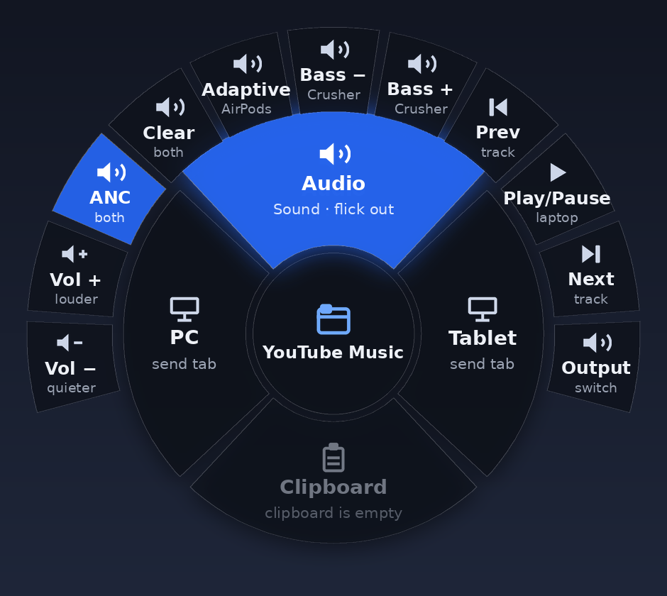
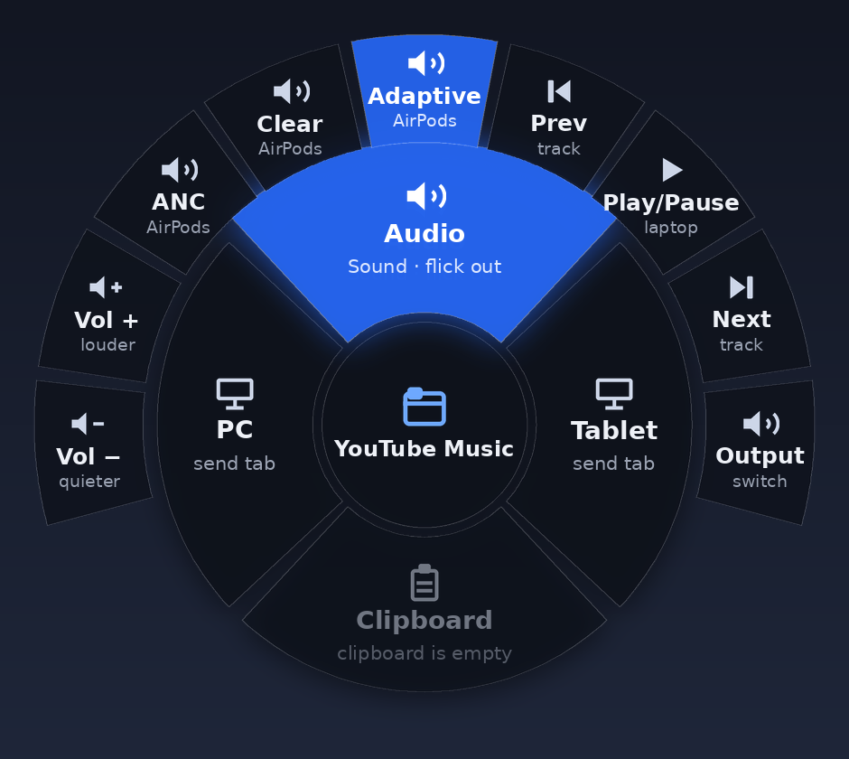
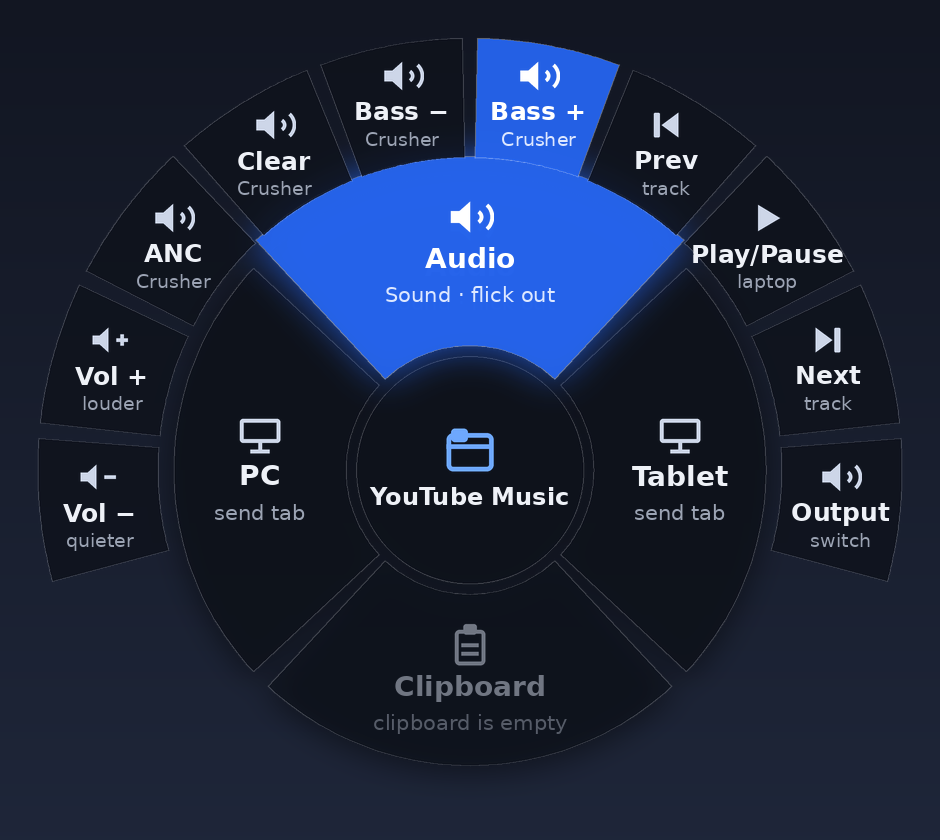
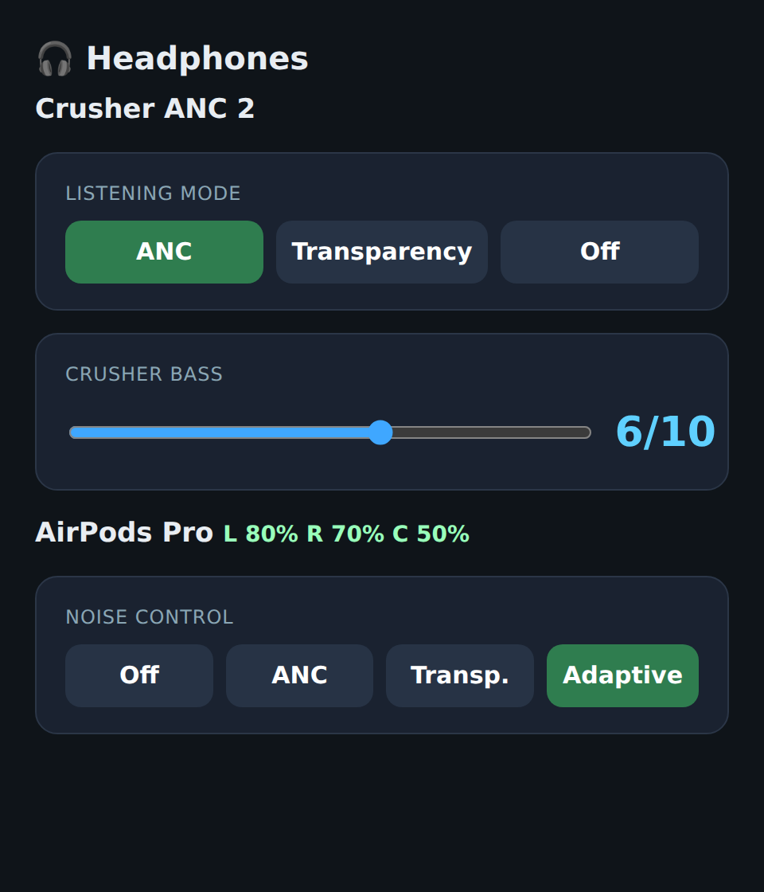
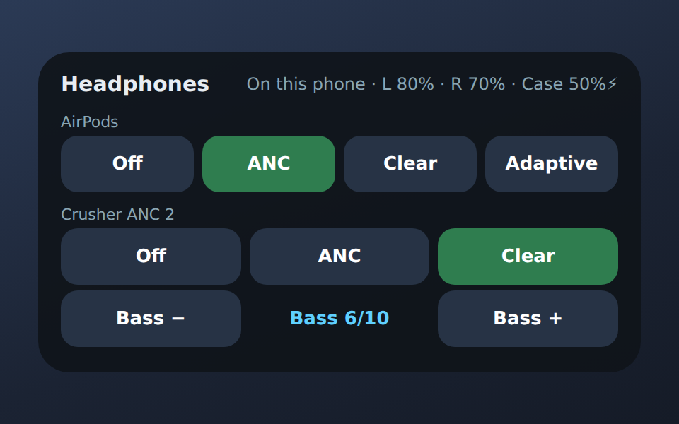
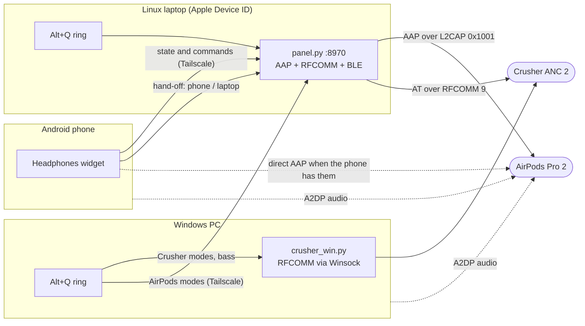
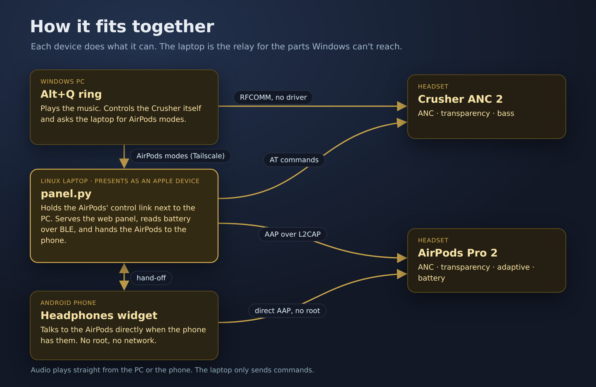
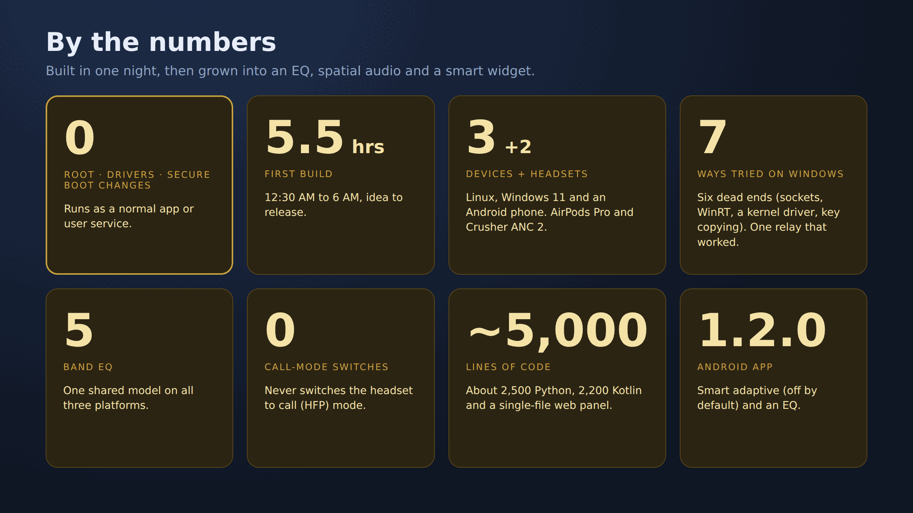

# crossdevice-audio

One set of headphone controls across a **Linux laptop**, a **Windows PC** and an **Android phone**,
for **AirPods Pro 2** and the **Skullcandy Crusher ANC 2**.

Noise cancelling, transparency, adaptive mode, bass, volume, media keys and battery are all available
from a radial flick menu on both computers, from a web panel, and from a home-screen widget on the phone.
It also has a shared 5-band EQ with a draggable curve, the AirPods' adaptive noise level and settings,
and the Crusher's extra settings (see [Customizing the sound](#customizing-the-sound)).

It doesn't need an iPhone, a kernel driver, a Secure Boot change, a USB dongle or a rooted phone.

<p align="center">
  
</p>

## What it does

| Where | How you use it | What you get |
|---|---|---|
| **Windows PC** | `Alt+Q`, flick up, then flick out | Volume, media keys and Crusher modes and bass. AirPods modes go through the laptop. |
| **Linux laptop** | `Alt+Q`, flick up, then flick out | The same ring, plus an audio output switcher. The laptop is what talks to the AirPods. |
| **Web panel** | `https://<laptop>:8970` over Tailscale | Every control with live state and AirPods battery. |
| **Android widget** | Home screen | AirPods modes and battery straight from the phone, with no laptop or Tailscale needed. When the AirPods aren't on the phone it works through the laptop. |

The ring only shows controls that the connected headphones can actually do. AirPods get Adaptive, the
Crusher gets Bass, and with nothing connected only volume and track controls are left:

| Both connected | AirPods only | Crusher only |
|---|---|---|
|  |  |  |

<p align="center">
  
  &nbsp;&nbsp;
  
</p>
<p align="center"><sub>Web panel (left) and the home-screen widget (right; a mockup of its real layout)</sub></p>

## The interesting parts

**1. AirPods noise control on Windows with no driver.**
AirPods are controlled through Apple's AAP protocol, which runs over classic Bluetooth L2CAP on
channel `0x1001`. Normal Windows programs can't open that kind of connection: Winsock's L2CAP sockets
fail with WSAESOCKTNOSUPPORT (10044) or WSAENETDOWN (10050), and WinRT has no classic L2CAP API at all.
The only way in is a kernel driver, which rules out Secure Boot on stock settings. Instead of fighting
Windows, this project gives the job to another machine:

- The **Linux laptop** presents Apple's Bluetooth Device ID (`DeviceID = bluetooth:004C:0000:0000`).
  AirPods only allow two connections at once to hosts that look like Apple devices.
- The **PC** keeps a normal Windows Device ID and plays the audio. The laptop holds a control-only AAP
  link with its audio profile switched off.
- When you pick ANC in the PC's ring, it asks the laptop over Tailscale, and the laptop sends the
  command to the AirPods.

**2. Pairing order matters, and nobody had written it down.** Two hosts that both present as Apple
share **one** pairing slot, so each new pairing cancels the other's key, and Windows logs "mutual
authentication failed". Copying the link key between hosts doesn't help, because the key is tied to
each host's address. What works is pairing the laptop as Apple first and then the PC as a normal
Windows host. The AirPods keep both pairings and both connections. See
[docs/HOW-IT-WORKS.md](docs/HOW-IT-WORKS.md).

**3. Direct control from a non-rooted Samsung phone.** Android has no public API for classic L2CAP,
and LibrePods documents root as required on Samsung. The widget reaches Android's *hidden* classic
L2CAP socket through [HiddenApiBypass](https://github.com/LSPosed/AndroidHiddenApiBypass), and on a
Galaxy S26 Ultra (One UI 8.5) the AirPods accept the connection. That gives noise modes from the
phone with no root, no laptop and no network.

**4. A phone-to-laptop hand-off.** The phone and the laptop can't share the AirPods: whichever one
joins knocks the other off. The widget listens for the AirPods connecting to and disconnecting from
the phone (`ACL_CONNECTED`/`ACL_DISCONNECTED`) and tells the laptop to let go or take them back. If the
phone can't reach the laptop, the laptop still steps aside on its own when it sees the phone's address
in the AirPods' connected-device list (AAP message `0x2E`).

**5. Battery without a connection.** AirPods broadcast their battery levels to anything nearby over
Bluetooth Low Energy (Apple manufacturer data `0x004C`, type `0x07`). Both the laptop and the phone read
this broadcast, so battery shows no matter which device is playing.

## Customizing the sound

| Control | AirPods Pro 2 | Crusher ANC 2 | Where |
|---|---|---|---|
| **EQ** (5 bands, presets Flat / Bass boost / Vocal / Treble / Custom, draggable curve) | Applied to the audio before it's sent, since AirPods have no EQ over AAP | Same, on top of its sensory bass | Panel (laptop output), Android app and widget (phone output), Windows (Equalizer APO), ring "EQ" wedge |
| Adaptive noise level, "Less noise ↔ More noise" | AAP `0x2E` | | Panel, Android app |
| Conversational Awareness, Personalized Volume, ear detection, one-bud ANC, "Off" in press and hold | AAP `0x28`, `0x26`, `0x0A`, `0x1B`, `0x34` | | Panel, Android app |
| Press-and-hold cycle (which modes) | AAP `0x1A` | | Panel, Android app |
| Sensory bass level and on/off | | `AT.CRUSHER` | Panel, Android app, `crusher_win.py`, ring |
| Transparency level, hear-through on calls / when paused | | `AT.UIAUDIO=transparency,,n`, `atoncall`, `atonpause` (shown only if the firmware answers) | Panel, Android app, `crusher_win.py` |

Every setting is read back from the device, so the controls show what the headphones report.

**The EQ is source-side.** It runs on whichever device is playing:
- **Laptop:** a PipeWire filter-chain sink (`laptop/hp_eq.py`).
- **Phone:** Android `audiofx`, with no root. It tries the global output, which is deprecated and only
  works if the phone honours it, and also attaches to music apps that offer their audio session to
  external EQs. The app says which of these it got. Apps that do neither (most video apps and browsers)
  can't be equalized without root.
- **Windows:** [Equalizer APO](https://sourceforge.net/projects/equalizerapo/) config, written by
  `windows/eq_apo.py`. Equalizer APO itself has to be installed.

All three use `shared/eq_presets.json`, so a preset sounds the same everywhere.

## How it fits together



<p align="center"></p>

## Repository layout

| Path | What it is |
|---|---|
| `laptop/panel.py` | The hub: an HTTP API and web page. It keeps the AirPods AAP link open, sends Crusher AT commands, reads BLE battery, and handles the phone hand-off. |
| `laptop/panel.html` | The panel's page: controls, the EQ curve you drag, and the adaptive noise slider. |
| `laptop/hp_eq.py` | The laptop EQ: a PipeWire filter-chain sink, updated live. |
| `shared/eq_presets.json` | The EQ bands and presets, shared by the laptop, the phone and Windows. |
| `windows/eq_apo.py` | The EQ on Windows through Equalizer APO's config (Equalizer APO must be installed). |
| `laptop/headphone-panel.service` | A systemd user service for the panel. |
| `laptop/apple-did.sh` | Switches BlueZ to Apple's Device ID (and back with `undo`). |
| `windows/crusher_win.py` | Crusher control on Windows with no driver: RFCOMM through Winsock `AF_BTH` via ctypes. |
| `ring/audio_ring_excerpt.py` | The Audio part of the Alt+Q ring: fan geometry, capability filtering, and the Windows connection check. |
| `android/` | The home-screen widget app (Kotlin, no AndroidX). |
| `docs/HOW-IT-WORKS.md` | The multi-device findings, with the packets that prove them. |
| `docs/PROTOCOL.md` | The Crusher AT commands, the AAP packets, the BLE battery format and the panel API. |

## Setup

### Laptop (Linux, BlueZ 5.x)

```bash
sudo bash laptop/apple-did.sh                 # Modalias should read bluetooth:v004Cp0000d0000
# re-pair the AirPods on the laptop (the AirPods remember a host's Device ID from pairing time)
mkdir -p ~/.config/headphone-panel ~/.local/share/headphone-panel ~/.config/systemd/user
cp laptop/config.example.json ~/.config/headphone-panel/config.json   # fill in your addresses
cp laptop/panel.py laptop/panel.html laptop/hp_eq.py shared/eq_presets.json ~/.local/share/headphone-panel/
cp laptop/headphone-panel.service ~/.config/systemd/user/
systemctl --user daemon-reload && systemctl --user enable --now headphone-panel
pactl set-card-profile bluez_card.<AIRPODS_MAC_WITH_UNDERSCORES> off   # control only, no audio
tailscale serve --bg --https 8970 http://127.0.0.1:8970               # reach it from the PC and phone
```

### Windows PC

Pair the AirPods **after** the laptop's Apple pairing, and leave the PC's Device ID at its default.
For the Crusher, set the `CRUSHER_MAC` environment variable and run `python windows\crusher_win.py anc on`.
No driver and no admin rights are needed. For the EQ, install Equalizer APO, tick your headphones in its
Device Selector, then run `python windows\eq_apo.py preset bass` (keep `shared\eq_presets.json` where
the script can find it: next to it, or at `..\shared\`).

### Android phone

Download the APK from [Releases](../../releases), or build it yourself with `cd android && ./gradlew assembleRelease`.
Install it, open **Headphones**, allow **Nearby devices** and notifications (the EQ runs as a small
foreground service while it's on), pick your AirPods from your paired devices, and optionally enter your
laptop panel URL. Then add the **Headphones** widget to your home screen. The app screen has the EQ
curve and the AirPods and Crusher settings. The widget shows a preview of the curve and a button that
cycles through the presets.
The APK has nothing about any particular device built in.

## What didn't work

- **A kernel driver for L2CAP on Windows.** It's possible, but loading one needs test-signing (which
  means turning Secure Boot off) or Microsoft attestation signing. That's too much to ask of anyone
  who just wants to use it.
- **Winsock and WinRT L2CAP:** `SOCK_SEQPACKET` fails with 10044 and `SOCK_STREAM` with 10050.
- **Copying the laptop's link key into the Windows registry:** the AirPods still reject it.
- **Phone and laptop connected at the same time:** whichever joins second kicks the other within a
  second. The PC and laptop pair coexists, but the phone and laptop pair doesn't, so there's a hand-off
  instead.
- **Three hosts:** AirPods hold two connections at most.

## Build notes

Built in one night (about 5.5 hours) across three devices and two headsets. Seven routes were tried
for AirPods on Windows before the two-device relay worked. The whole thing is about 1,250 lines of
code, and none of it needs root, a driver or a Secure Boot change.

<p align="center"></p>

## Credits

- [LibrePods](https://github.com/kavishdevar/librepods): AAP research, the Device ID trick and the control-command ids.
- [apple-wireshark](https://github.com/pabloaul/apple-wireshark): AAP opcode names.
- [OpenPods](https://github.com/adolfintel/OpenPods): the BLE proximity-broadcast battery layout.
- [AndroidHiddenApiBypass](https://github.com/LSPosed/AndroidHiddenApiBypass).

Not affiliated with Apple or Skullcandy. AirPods is a trademark of Apple Inc.
